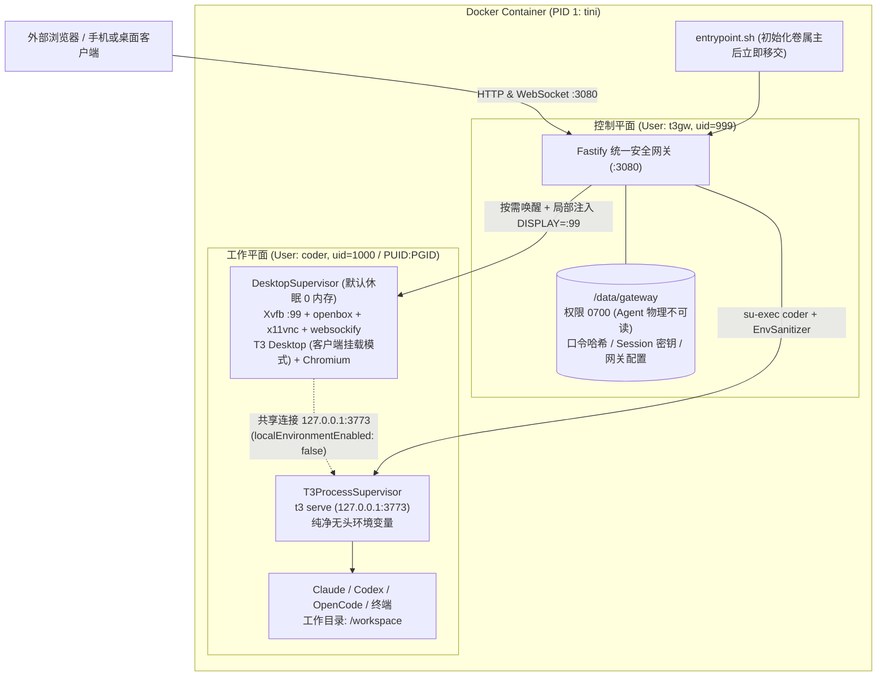
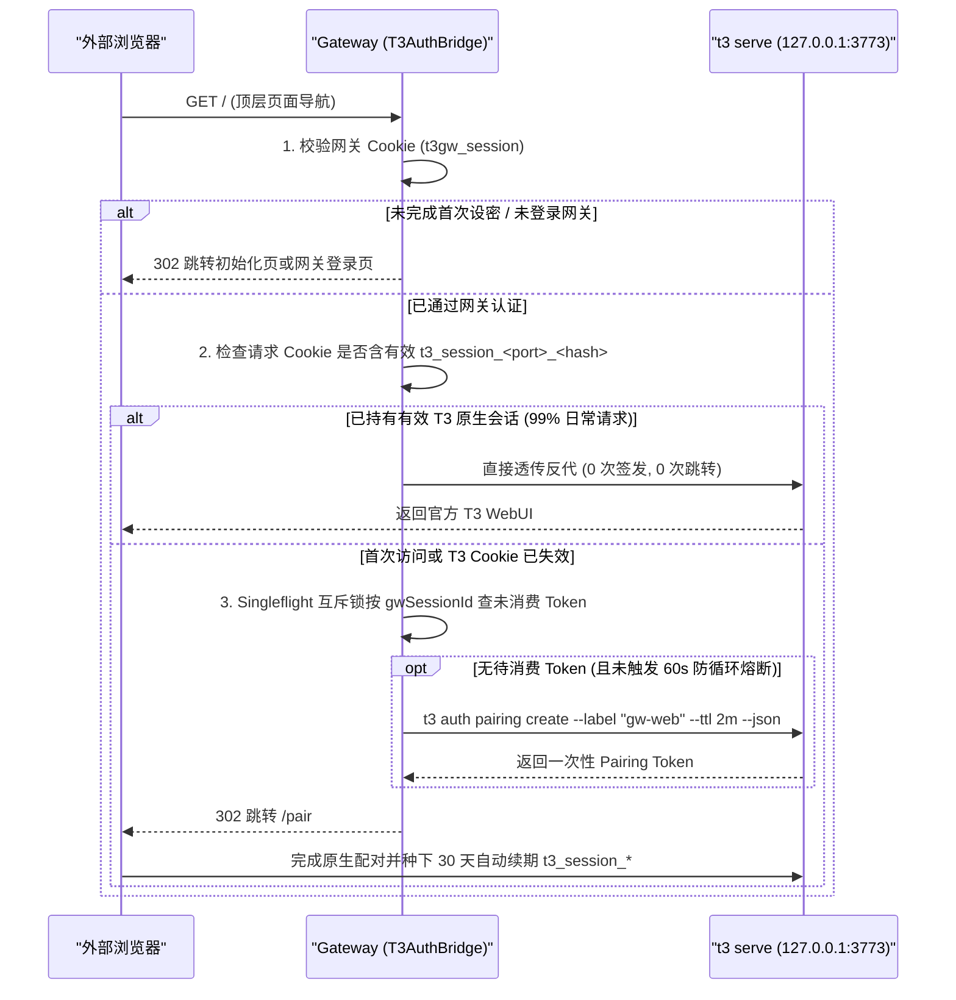
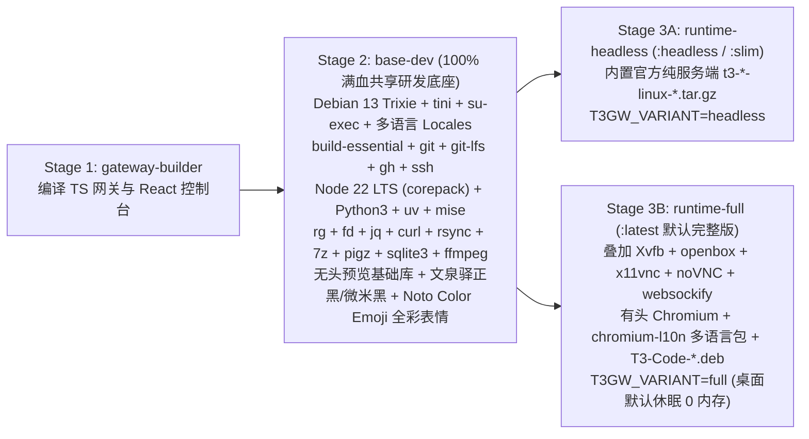

# t3code-docker 系统架构与工程规划设计书

> **文档状态**：V1.0 定稿基线  
> **核心定位**：专为官方 [T3 Code (`pingdotgg/t3code`)](https://github.com/pingdotgg/t3code) 打造的生产级自托管容器套件——提供 **1:1 官方同源视觉风格的统一安全网关、零侵入官方原版热更新与回滚、T3 Connect 可视化管控、按需休眠 VNC 桌面版双端共生，以及 100% 满血零阉割的多语言研发底座**。

---

## 目录

1. [设计背景与四大工程铁律](#1-设计背景与四大工程铁律)
2. [整体系统拓扑与安全隔离模型](#2-整体系统拓扑与安全隔离模型)
3. [单端口动态路由与防重签鉴权架构](#3-单端口动态路由与防重签鉴权架构)
4. [六大核心业务子系统详细设计](#4-六大核心业务子系统详细设计)
5. [前端视觉规范与多语言国际化 (i18n)](#5-前端视觉规范与多语言国际化-i18n)
6. [Docker 多阶段镜像与持久化卷规范](#6-docker-多阶段镜像与持久化卷规范)
7. [Monorepo 目录蓝图与模块边界](#7-monorepo-目录蓝图与模块边界)
8. [网关内部 API 契约总览](#8-网关内部-api-契约总览)
9. [分阶段实施路线图与质量门禁](#9-分阶段实施路线图与质量门禁)

---

## 1. 设计背景与四大工程铁律

在吸取 `deepseek-harness-docker` 与社区同类项目（如 `dizys/t3code-docker`）的正反两面经验后，本项目确立以下 **四条不可妥协的工程红线**：

| 历史痛点与反模式 | `t3code-docker` 工程铁律 |
| :--- | :--- |
| **无类型巨石代码**：单文件近百 KB 的裸 JS/CJS 与近 300 KB 的手搓单文件 HTML/CSS，状态散落全局变量，极易回归崩坏 | **铁律一：100% TypeScript 强类型工程化**<br>全仓启用 `strict: true`、`noUncheckedIndexedAccess: true`；后端模块化拆分、前端采用 React 19 + Tailwind v4 组件化开发，单文件职责单一（常规 ≤ 300 行）。 |
| **脆弱的上游魔改补丁**：用正则硬改压缩后的 JS Bundle，或每小时拉上游源码打补丁重编译，上游一发版即崩 | **铁律二：100% 零侵入官方原版产物（Zero Monkey-Patching）**<br>直接运行官方发布的原版二进制/包并校验官方 `SHA256SUMS`；所有增强能力严格通过反向代理层与 T3 官方 CLI / HTTP 控制面实现。 |
| **精简版阉割研发工具链**：为了压缩体积砍掉 `gh`、编译器或运行库，导致 Agent 在容器内编译项目频频报错 | **铁律三：满血研发底座零阉割**<br>`:latest` 与 `:headless`（`:slim`）共享 **100% 完全一致的满血编译与研发底座**；全局唯一变体差异仅为 `capabilities.desktopSupported`（是否搭载虚拟桌面与有头 GUI 软件）。 |
| **版本号分裂与野生测试脚本**：多处手写版本号漏改导致误报更新，几十个零散脚本难以维护 | **铁律四：单一真源与契约驱动**<br>根 `package.json` 为唯一工程版本真源；`@t3-docker/shared` 通过 Zod 统一定义环境变量、持久化配置与前后端 API 契约；统一使用 Vitest 自动化测试套件。 |

---

## 2. 整体系统拓扑与安全隔离模型

### 2.1 容器内进程与权限拓扑图

AI 编码容器内的 Agent 具备终端命令执行权限，若网关与 Agent 共享同一用户或环境变量，极易引发机密泄露与项目环境污染。本项目采用 **双 UID 内核级权限分离 + 子进程环境净化器** 架构：



### 2.2 六大全局污染与越权风险硬隔离规则

1. **严禁全局设置 `NODE_ENV=production`**：
   - 网关自身运行模式统一使用私有变量 `T3GW_RUNTIME_MODE=production`；派生 `t3 serve` 前由 `EnvSanitizer` 剥离所有 `T3GW_*` 变量并确保 `NODE_ENV` 未定义，防止用户在 `/workspace` 执行 `npm/pnpm install` 时静默漏装 `devDependencies`。
2. **严禁泄漏 `ELECTRON_RUN_AS_NODE`**：
   - 在 Full 镜像复用桌面包内置 `server.asar` 启动 `t3 serve` 时，通过轻量引导脚本在加载入口前立即执行 `delete process.env.ELECTRON_RUN_AS_NODE` 与 `delete process.env.T3CODE_DESKTOP_CLI_LAUNCHER`，杜绝污染用户在工作区内开发的 Electron / Playwright 项目。
3. **严禁全局设置 `DISPLAY` 与 `DBUS_SESSION_BUS_ADDRESS`**：
   - 默认无头态下所有终端与 `t3 serve` 均无 `DISPLAY` 变量，避免 `git`、`ssh`、`gh` 在桌面休眠时因尝试连接 `:99` X11 Server 而阻塞报错；仅在 `DesktopSupervisor` 唤醒桌面子进程组时局部注入 `DISPLAY=:99`。
4. **网关机密物理隔离（防 Prompt Injection 窃密）**：
   - `AUTH_TOKEN`、`SESSION_SECRET` 在网关启动读取落盘后立即从内存 `process.env` 销毁；`/data/gateway` 属主锁死为 `t3gw:t3gw (0700)`，运行在 `coder (uid=1000)` 下的 AI Agent 在操作系统内核层面无权读取网关凭据或强杀网关进程。
5. **四层包路径解耦（防全局包升级互踩）**：
   - `/opt/t3-gateway`：网关只读程序目录；
   - `/data/t3/runtime/versions/<ver>`：T3 官方自包含版本槽位；
   - `/data/providers` & `/data/toolchains/mise`：后台受管安装的 Agent CLI 与多语言工具链；
   - `/home/coder/.local` & `/workspace`：用户与 Agent 自由支配空间。
6. **宿主机边界与同卷原子操作**：
   - 默认开启 `no-new-privileges:true`、不挂载 `/var/run/docker.sock`、配置 `shm_size: 1gb` 与 `stop_grace_period: 45s`；
   - 所有大体积版本下载、解压与快照打包统一在同数据卷下的 `/data/t3/.staging` 进行，禁止使用内存盘 `/tmp`，确保防 OOM 且 `rename` 为同文件系统原子操作。

---

## 3. 单端口动态路由与防重签鉴权架构

### 3.1 动态路径与固定内部命名空间设计

对外仅暴露单一端口（默认 `3080`），同时支持环境变量与后台**免重编译热修改路径**：

| 路由空间 | 默认值 | 配置方式 | 职责说明 |
| :--- | :--- | :--- | :--- |
| **网关内部固定端点** | `/_t3gw/*` | 系统保留常量 | 承载控制台静态资源 `/_t3gw/assets/*`、网关 REST/SSE API `/_t3gw/api/*`、登录与初始化接口。**因内部 API 前缀固定，用户在后台任意热修改 `/admin` 路径均无需重新构建前端静态包**。 |
| **管理控制台入口** | `/admin` | `ADMIN_PATH` 或后台设置 | 渲染 T3 风格管理控制台 SPA（未认证跳登录页，未初始化跳引导页）。 |
| **虚拟桌面入口** | `/vnc` | `VNC_PATH` 或后台设置 | Full 镜像下：若桌面休眠则展示唤醒页并触发启动，运行中则反代至回环 `noVNC/websockify`（带静态资源版本前缀防缓存）；Headless 镜像下硬阻断返回 `404`。 |
| **主工作区（兜底）** | `/` 及其余路径 | 原生保持 | 通过网关会话校验后，全双工反向代理（HTTP + WebSocket Upgrade）至 `127.0.0.1:3773`（T3 Code 官方 WebUI）。 |

> [!IMPORTANT]
> **保留路由冲突校验**：Zod 配置校验器禁止将 `ADMIN_PATH` 或 `VNC_PATH` 设置为 `/`、`/pair`、`/api`、`/mcp`、`/.well-known`、`/assets`、`/_t3gw` 或两者相同的值，防止遮蔽 T3 Code WebUI 核心路由。

### 3.2 `T3AuthBridge` 零重复签发（幂等配对与会话复用）

T3 Code Server 原生采用「一次性配对码换取 30 天自动滑动续期会话」机制（浏览器存 `t3_session_<port>_<hash>` Cookie，桌面客户端存 `saved-environments.json` + DPoP 密钥）。全局唯一收口的 `T3AuthBridge` 通过四道幂等锁彻底杜绝重复签发与僵尸会话堆积：



- **VNC 内置 T3 桌面版防重签**：`DesktopSupervisor` 拉起桌面版前检查 `saved-environments.json` 并调用 `t3 auth session list --json` 核验唯一标签 `gw-vnc-desktop`。只要会话有效即**零参数直接启动 `t3-code`**（自动复用本地 DPoP 持久会话，0 次签发）；仅在首次启动或会话被手动吊销时，先清理残留同名项再签发唯一一枚绑定凭据。
- **后台手动扫码配对防堆积**：后台点击「生成手机/外部桌面配对二维码」时，若已存在未过期未消费的手动配对码则直接复用并展示倒计时；点击「重新生成」时先自动 `revoke` 旧码再签新码。
- **改密联动清退**：管理员修改网关密码并勾选「清退所有已授权设备」时，联动吊销全部网关会话、全部未消费 Pairing Token，并支持一键吊销 T3 活跃外部会话。

---

## 4. 六大核心业务子系统详细设计

### 4.1 `T3ProcessSupervisor`（核心进程守护状态机）
- **明确状态机**：`stopped` → `starting` → `healthy` → `restarting` | `updating` | `maintenance`（供快照还原与 `t3 doctor` 独占停服锁使用）→ `degraded`（异常崩溃指数退避自愈重启：`1s -> 2s -> 4s -> 10s`）。
- **就绪与健康探针**：轮询 `GET http://127.0.0.1:3773/.well-known/t3/environment`，同步提取 `environmentId` 与精确的 `sessionCookieName`。
- **可观测性**：内置固定容量环形日志缓冲（RingBuffer 2000 行）+ `/_t3gw/api/supervisor/logs/stream` SSE 实时流推送；集成一键运行 `t3 doctor --fix` 数据库空间回收。

### 4.2 `VersionHubService`（官方原版热更新与秒级回滚）
- **双通道探测与缓存**：支持 `stable` 与 `nightly` 通道切换，查询 `pingdotgg/t3code` Releases（内置 ETag 与 10 分钟 TTL 缓存防 GitHub API 限流，支持配置 `T3CODE_RELEASE_BASE_URL` 加速源）。
- **统一版本槽位布局**：
  - 所有版本统一存放于持久化卷 `/data/t3/runtime/versions/<version>/`（带 `.install-complete` 完整性校验印章）并通过 `/data/t3/runtime/current` 符号链接指向当前激活版本。
  - **Full 镜像**：下载 `T3-Code-<ver>-<arch>.deb`，校验官方 `SHA256SUMS` 后在 `/data/t3/.staging` 使用 `dpkg-deb -x` 解包——**升级一次即可同步更新 `t3 serve` 服务端与 VNC 内的 T3 桌面客户端**。
  - **Headless 镜像**：下载 `t3-<ver>-linux-<arch>.tar.gz`，校验官方 `SHA256SUMS` 后原子解包。
- **安全切换与失败自动回滚流水线**：
  1. 预检数据卷剩余空间（默认阈值 `≥ 1536 MB`）；
  2. 自动创建升级前轻量快照（记录原版本号与备份归档 ID）；
  3. 下载并校验 `SHA256SUMS`，原子移动至 `versions/<targetVer>`；
  4. 获取 Supervisor 切换锁，平滑停止旧版 `t3 serve`（若 VNC 桌面内开着 T3 桌面版客户端则平滑重启该窗口）；
  5. 原子切换 `current` 软链并拉起新版 `t3 serve`；
  6. **30 秒健康探针验收**：若新版在超时内连续崩溃或未通过探针，**自动将 `current` 切回原版本并重新拉起服务**，同时向后台推送回滚诊断日志。

### 4.3 `DesktopSupervisor`（按需休眠虚拟桌面、双端共生与浏览器语言同步）
- **能力硬边界**：由构建期烘焙的只读环境变量 `T3GW_VARIANT=full|headless` 派生唯一能力布尔值 `capabilities.desktopSupported`。`headless` 变体装配零开销 Stub。
- **默认零内存休眠**：容器启动后默认处于 `hibernated` 态（不启动 `Xvfb`、`x11vnc`、窗口管理器或任何浏览器进程，占 0 MB 内存）。
- **一键启停与双端无缝共生**：
  - 在后台点击「启动桌面」或打开 `/vnc` 时，创建独立进程组依次启动：`Xvfb :99`（支持后台动态设置 `1920x1080` / `2560x1440` / 自定义分辨率）→ `openbox` → `x11vnc -localhost` → `websockify/noVNC`。
  - 拉起 **T3 Desktop** 前，原子确保 `$T3CODE_HOME/userdata/desktop-settings.json` 中 `"localEnvironmentEnabled": false`，携带 `--no-sandbox --disable-dev-shm-usage --password-store=basic` 启动，**直接连接已在后台运行的 `127.0.0.1:3773` 后端**——WebUI 与桌面版实时同步，关闭桌面仅杀桌面进程组 `-PGID`，绝不打断运行中的 Agent 任务。
  - 桌面内同时配备有头 **Chromium 浏览器** 快捷入口，供 Claude / Codex / Google / Antigravity 等强制 `http://localhost:<port>/callback` 的 OAuth 授权在容器本机一键闭环。
- **浏览器与 Electron 多语言精确同步（根治 Linux `LANGUAGE` 环境变量压制 `--lang` 问题）**：
  - **历史痛点规避**：在 Debian/Linux 下，一是不装 `chromium-l10n` 会导致仅剩英文 `en-US.pak` 使 `--lang` 完全失效；二是 Glibc/GTK 下环境变量优先级为 `LANGUAGE > LC_ALL > LANG > --lang`，若容器写死全局 `LC_ALL` 或 `LANGUAGE`，浏览器 UI 语言将无法随设置切换。
  - **统一 `BrowserLocaleResolver` 三件套注入**：
    1. 镜像预生成 `C.UTF-8`、`zh_CN.UTF-8`、`en_US.UTF-8` 等多套系统 Locale，**严禁在全局锁死 `LC_ALL` 与 `LANGUAGE`**；Full 镜像内置 `chromium-l10n` 并保留主流 10+ 语言 `.pak` 包；
    2. 解析优先级：`桌面显式语言覆盖` > `T3 客户端语言偏好` > `网关当前激活语言 (默认 zh-CN)`；
    3. 启动有头 Chromium 与 T3 Desktop 子进程时，同步注入：**① 命令行 `--lang=<bcp47>`（置于 URL 之前）**、**② `--accept-lang=<bcp47>,<primary>`（同步网页 `Accept-Language` 与 `navigator.languages`）**、**③ 子进程局部环境变量 `LANG=<posix>.UTF-8` 与 `LANGUAGE=<posix>:<primary>`**；后台切换语言时若桌面运行中支持平滑重启桌面同步 UI 语言。
- **智能空闲休眠**：实时追踪 `/vnc` 的活跃 WebSocket 连接数与有头浏览器 MCP 活动时间戳；当空闲超过设定阈值（默认 30 分钟，支持调整或设为 `0` 常驻）自动优雅休眠回收全部 GUI 内存。

### 4.4 双轨浏览器架构：无头浏览器 vs 有头桌面浏览器（100% 标准 MCP、零注入）

不同于 `deepseek-harness-docker` 需要编写私有插件与前端注入，T3 Code 全系 Agent（Claude Code、Codex、OpenCode、Antigravity、Cursor 等）均原生支持标准 **MCP (Model Context Protocol)**。本项目采用 **「无头 + 有头」双轨纯 MCP 架构，对 T3 Code 100% 零代码注入**：

| 维度 | 轨道一：无头浏览器 (Headless Browser) | 轨道二：有头桌面浏览器 (Headed Desktop Browser) |
| :--- | :--- | :--- |
| **适用镜像** | `:latest` 与 `:headless` **100% 全支持** | 仅 `:latest`（Full 镜像，默认休眠 0 内存） |
| **底层内核** | T3 官方 `ServerBrowser` 自管理的 `chrome-headless-shell`（原生支持 `linux64` 与 `linux-arm64`，自动持久化至 `$T3CODE_HOME/userdata/tools/`） | VNC 虚拟桌面内的真实有头 `/usr/bin/chromium`（监听回环 CDP `127.0.0.1:9222`） |
| **Agent 调用协议** | **① T3 官方内置 MCP (`t3-code`: `preview_*` / `html_render`)** 开箱即用<br>**② 可选一键注册标准无头 `@playwright/mcp`** | **标准 MCP 服务 (`@t3-docker/desktop-browser-mcp`)**<br>底层通过 Playwright/CDP 桥接 `127.0.0.1:9222`，一键注册至各 Agent 原生 MCP 配置 |
| **核心运行机制** | 共享底座 `base-dev` 精确预装官方 `PreviewBrowserHost.ts` 要求的 17 个 Debian `t64` 系统库（`libnss3`、`libgbm1`、`libasound2t64` 等），并向 `t3 serve` 传入官方支持的 `T3CODE_SERVER_BROWSER_SANDBOX=0`；后台提供「预热下载无头内核」按钮防止慢网首次 60s 调用超时 | **按需自动唤醒 + 人机同屏接管**：当 Agent 调用该有头 MCP 工具时，若 `DesktopSupervisor` 处于休眠态，MCP 桥接器自动通知网关 **1~2 秒内拉起 VNC 与有头 Chromium** 并刷新休眠计时器；遇到登录/验证码时用户可随时打开 `/vnc` 鼠标人工接管，完成后 Agent 无缝继续执行 |

### 4.5 `T3ConnectService`（控制台原生管控 T3 Connect 开关）
针对自托管域名下官方 WebUI 无法直接唤起 Clerk 登录的问题，在 `/admin` 原生封装完整生命周期：
- **总开关控制（免重复扫码）**：
  - **首次开启**（未绑定授权）：后台启动 `t3 connect link --headless` 子任务，实时解析流式输出并通过 SSE/轮询向前端弹窗展示 **授权跳转链接 + 8 位确认码（一键复制）**；授权通过后自动平滑生效。
  - **日常关闭开关**：调用 `t3 connect unlink --base-dir /data/t3`（断开云中继隧道，但保留本地账号授权凭据）。
  - **日常重新开启**：检测到本地已有有效授权时，直接调用 `t3 connect link --base-dir /data/t3` 快速恢复隧道，无需再次扫码验证。
  - **活跃任务保护**：若状态切换需重启 `t3 serve` 且检测到活跃任务，提供「待空闲时自动生效」与「立即重启生效」双选项。
- **免重启实时子开关 & 设备审批**：
  - 对接回环 `/api/connect/link-state` 与 `/api/connect/preferences`，实时热切换「手机端实时活动推送 (`publishAgentActivity`)」与「离线暂存 Webhook (`holdWebhooksWhileOffline`)」；
  - 对接 `t3 auth connect-device list / approve / revoke`，在控制台直接审批或吊销新接入手机/设备；
  - 提供独立危险操作「彻底退出并清除账号授权（`t3 connect logout`）」。

### 4.6 `ProviderToolchainService`（Agent 生态与 `mise` 工具链）
- **全生态 Agent CLI 管理**：内置 `Claude Code`、`Codex`、`OpenCode`、`Antigravity`、`Pi`、`Grok` 清单。统一安装于持久化卷 `/data/providers`（规避闭源 CLI 镜像预打包协议限制），支持 `T3_PREINSTALL=core|none|all` 首次启动后台自动安装，以及控制台一键安装、升级、卸载与版本探测。
- **工作平面出站代理隔离注入**：统一管理出站代理（`HTTP_PROXY` / `HTTPS_PROXY` / `ALL_PROXY` / `NO_PROXY`），仅向 `coder` 工作平面注入并与网关凭据严格物理隔离。
- **`mise` 多语言工具链面板**：基于底座内置的 `mise` 与 `uv`，在控制台提供 `Go`、`Rust`、`Bun`、`Deno`、`glab` (GitLab)、`tea` (Gitea) 的状态查看与按需一键持久化安装。

### 4.7 `SnapshotService`（SQLite 安全快照与防呆还原）
- **双粒度快照**：
  - `config`（轻量配置级）：备份网关设置、`userdata` JSON 配置、自定义主题与 Provider 配置；
  - `full`（全量状态级）：额外包含 T3 SQLite 核心数据库（采用 SQLite 在线备份机制生成一致性副本，备份过程无需停服！自动排除可重新下载的 `runtime/versions` 二进制目录以保持快照小巧）。
- **防呆还原机制**：
  - 归档导入前严格执行安全扫描：校验 `manifest.json` 版本与 SHA256、拒绝任何含 `..` 或绝对路径或越界软链的条目（防 Zip-Slip）、限制最大条目数与解压总大小；
  - 执行还原时强制获取 `T3ProcessSupervisor` 的 `maintenance` 独占锁，平滑停止 `t3 serve` 与桌面客户端，清理残留 `-wal`/`-shm` 文件后原子替换，最后重新拉起服务并过健康探针。

---

## 5. 前端视觉规范与多语言国际化 (i18n)

### 5.1 1:1 复刻 T3 Code 官方 WebUI 设计系统
控制台（`packages/console`）采用 **React 19 + Vite + Tailwind CSS v4 + Radix UI + Lucide Icons**，直接对齐 T3 Code 官方 `apps/web` 的视觉细节：
- **色彩与材质**：完整映射 `--background`、`--sidebar`、`--card`、`--popover`、`--border`、`--primary`、`--muted-foreground`、`--warning`、`--error`、`--success` 语义色阶，支持 **深色 (Dark) / 浅色 (Light) / 跟随系统 (System)**，浮层与顶栏复用同款 `surface-glass` 毛玻璃滤镜（`backdrop-filter: blur(12px~16px) saturate(1.08~1.14)`）。
- **紧凑几何尺度**：顶栏固定 `52px`、侧边栏内边距 `0.5rem`、标准控件圆角 `8px` (`0.5rem`)、卡片圆角 `12px` 配 `1px` 微边框与微妙顶边内高光，版本号/PID/哈希/日志统一采用等宽字体栈（`SF Mono / Consolas`）。
- **统一交互骨架**：
  - **初始化向导页 (`/setup`) & 登录页 (`/login`)**：纯净画布居中单卡片（复刻 T3 Composer 悬浮质感），支持键盘 `Enter` 极速提交与错误限流倒计时反馈。
  - **管理控制台 (`/admin`)**：复刻 T3 Settings 的「左侧紧凑分组侧边栏 + 右侧限宽内容滚动区（响应式适配桌面与手机抽屉）」布局，左上角常驻 **`← 返回 T3 Code`** 按钮，顶栏常驻核心运行状态脉冲灯、当前版本芯片、主题切换与语言切换器。

### 5.2 多语言国际化与全彩 Emoji 字体规范（默认简体中文 `zh-CN`）
1. **默认语言策略**：未手动修改语言偏好时，所有网关界面（初始化页、登录页、桌面唤醒页、`/admin` 控制台、接口业务提示）**默认强制使用 `简体中文 (zh-CN)`**，同时内置完整 **`English (en-US)`**（架构支持无损扩展日/韩/西/法/德等语言）。
2. **编译期强类型防漏翻**：
   - 以 `packages/console/src/i18n/locales/zh-CN.ts` 导出对象推导基准类型 `export type TranslationDict = typeof zhCN`；
   - `en-US.ts` 声明 `satisfies TranslationDict`，任何新增功能若漏写任一语言的文案，`tsc --noEmit` 直接编译失败阻断提交。
3. **跨层语言同步**：切换语言实时无刷新生效并持久化至网关配置；通过 `BrowserLocaleResolver` 自动联动 VNC 桌面及容器浏览器的 `LANGUAGE` / `LANG` / `--lang` / `--accept-lang`。
4. **全彩 Emoji 与中日韩字体零阉割支持（双镜像共享基线）**：
   - **历史痛点规避**：精简镜像若剥离 `fonts-noto-color-emoji` 会导致 T3 内置的 `html_render` 卡片渲染与无头网页截图出现 `□` 豆腐块；而 Fontconfig 若将单色符号字体排在彩色 Emoji 之前，会导致 Emoji 退化为黑白线框符号。
   - **双变体统一内置**：在共享 `base-dev` 底座层（即 `:latest` 与 `:headless` **100% 全部包含**）统一预装 `fonts-wqy-zenhei`、`fonts-wqy-microhei`、**`fonts-noto-color-emoji`** 与 `fonts-symbola`；
   - **标准 `/etc/fonts/local.conf` 优先级锁死**：在 `sans-serif`、`serif`、`monospace` 字体族中强制按 **`中日韩主字体 -> Noto Color Emoji -> Symbola`** 顺序回退，并显式绑定 `emoji` 族至 `Noto Color Emoji`，确保终端、无头截图、`html_render` 图表与 VNC 桌面均完整渲染高清彩色 Emoji。

---

## 6. Docker 多阶段镜像与持久化卷规范

### 6.1 满血零阉割多阶段构建矩阵（原生支持 `linux/amd64` + `linux/arm64`）



- **GitHub Actions 自动编译与 GHCR 发布地址**（[查看 GitHub Container Registry 镜像主页](https://github.com/misaka-link/t3code-docker/pkgs/container/t3code-docker)）：
  - `ghcr.io/misaka-link/t3code-docker:latest`（及版本标签 `:<ver>` / `:v<ver>`）→ 指向 `full`（`linux/amd64` + `linux/arm64` 原生双架构 Manifest）；
  - `ghcr.io/misaka-link/t3code-docker:headless` / `ghcr.io/misaka-link/t3code-docker:slim`（及 `:<ver>-headless`）→ 指向 `headless`（`linux/amd64` + `linux/arm64` 原生双架构 Manifest）。

### 6.2 标准持久化数据卷规划

| 容器内路径 | 推荐宿主机挂载 | 属主与权限 | 存储内容说明 |
| :--- | :--- | :--- | :--- |
| `/data/gateway` | `./data/gateway` | `t3gw:t3gw (0700)` | 网关口令哈希、Session 签名密钥、`gateway.config.json`（与 Agent 内核隔离） |
| `/data/t3` | `./data/t3` | `coder:coder (0755)` | `T3CODE_HOME`：含 `userdata/`（SQLite 数据库、T3 Connect 授权、配对状态）、`runtime/versions/` 多版本缓存与 `.staging/` |
| `/data/providers` | `./data/providers` | `coder:coder (0755)` | 在线安装的各家 Agent CLI（Claude / Codex / OpenCode 等）与 `mise` 持久化工具链 |
| `/home/coder` | `./data/home` | `coder:coder (0750)` | 各 Agent 登录态配置（`~/.claude`、`~/.codex`、`~/.config`、SSH/Git 配置），重建容器不掉登录 |
| `/data/snapshots` | `./data/snapshots` | `root:root (0700)` | 自动升级前备份与手动快照归档包 |
| `/workspace` | `./workspace` | `coder:coder (0755)` | 默认 AI 研发项目代码工作区 |

### 6.3 全参数单文件 `docker-compose.yml` 参考模板（免 `.env`）

```yaml
services:
  t3code:
    image: ghcr.io/misaka-link/t3code-docker:latest # 无桌面版改为 :headless
    container_name: t3code
    restart: unless-stopped
    init: true
    shm_size: "1gb"
    stop_grace_period: 45s
    ports:
      - "3080:3080"
    environment:
      PROXY_PORT: "3080"
      AUTH_TOKEN: ""               # 留空首次打开进入设密向导
      SESSION_SECRET: ""           # 留空自动生成随机签名密钥
      ADMIN_PATH: "/admin"         # 管理后台路径（支持热改）
      VNC_PATH: "/vnc"             # 虚拟桌面路径（支持热改）
      DEFAULT_LOCALE: "zh-CN"      # zh-CN | en-US
      RELEASE_CHANNEL: "stable"    # stable | nightly
      PUID: "1000"
      PGID: "1000"
      TZ: "Asia/Shanghai"
      T3_PREINSTALL: "core"        # core | all | none
      DESKTOP_WIDTH: "1920"
      DESKTOP_HEIGHT: "1080"
      DESKTOP_IDLE_MINUTES: "30"
      TRUST_PROXY: "0"
      PUBLIC_URL: ""
      HTTP_PROXY: ""
      HTTPS_PROXY: ""
      ALL_PROXY: ""
      NO_PROXY: "localhost,127.0.0.1,::1"
    security_opt:
      - no-new-privileges:true
    cap_drop: [ALL]
    cap_add: [CHOWN, DAC_OVERRIDE, FOWNER, SETUID, SETGID, KILL]
    volumes:
      - ./data/gateway:/data/gateway
      - ./data/t3:/data/t3
      - ./data/providers:/data/providers
      - ./data/home:/home/coder
      - ./data/snapshots:/data/snapshots
      - ./workspace:/workspace
```

---

## 7. Monorepo 目录蓝图与模块边界

```text
t3code-docker/
├── package.json                       # Monorepo 根配置 & 唯一工程版本号真源
├── pnpm-workspace.yaml                # Workspace 包声明
├── tsconfig.base.json                 # 全局严格 TypeScript 编译基线
├── vitest.workspace.ts                # 统一单元与集成测试入口
├── docs/
│   └── ARCHITECTURE.md                # 本系统架构与规划设计书
├── packages/
│   ├── shared/                        # @t3-docker/shared：前后端共享契约层
│   │   └── src/
│   │       ├── env.schema.ts          # 环境变量 Zod 解析与默认值
│   │       ├── config.schema.ts       # 动态持久化配置与路径防冲突校验
│   │       ├── api.contracts.ts       # 所有模块请求/响应 DTO Zod Schemas
│   │       └── constants.ts           # 保留路由、错误码、Agent 与工具清单常量
│   ├── gateway/                       # @t3-docker/gateway：Fastify 安全网关与编排核心
│   │   ├── src/
│   │   │   ├── index.ts               # 进程入口、优雅停机信号处理
│   │   │   ├── app.ts                 # Fastify 实例装配、动态路由分发与 HTTP/WS 反代
│   │   │   ├── config/                # ConfigStore（原子写 + 内存热重载）
│   │   │   ├── security/              # 口令 scrypt 哈希、签名 Session、IP 限流、EnvSanitizer
│   │   │   ├── auth-bridge/           # T3AuthBridge（幂等配对、防重签 Singleflight、会话管理）
│   │   │   ├── supervisor/            # T3ProcessSupervisor（状态机、探针、RingBuffer SSE 日志）
│   │   │   ├── versions/              # VersionHubService（Release 探测、SHA256、原子切换与自动回滚）
│   │   │   ├── desktop/               # DesktopSupervisor（按需 Xvfb/VNC、空闲休眠、桌面端挂载）
│   │   │   ├── connect/               # T3ConnectService（设备码流解析、unlink/link 开关、设备审批）
│   │   │   ├── providers/             # ProviderToolchainService（Agent CLI、浏览器 MCP、mise 工具链）
│   │   │   ├── snapshots/             # SnapshotService（SQLite 安全备份、归档安全校验与停服还原）
│   │   │   └── routes/                # 按领域拆分的 `/_t3gw/api/*` 路由控制器
│   │   └── test/                      # 网关各模块单元与集成测试
│   └── console/                       # @t3-docker/console：T3 风格 Web 控制台与门禁页
│       └── src/
│           ├── i18n/                  # 编译期强类型多语言字典（默认 zh-CN + en-US）
│           ├── styles/                # T3 Code 官方同源 Tailwind v4 主题变量
│           ├── components/ui/         # 原子组件（Button, Card, Switch, Dialog, Badge, LogViewer...）
│           ├── components/layout/     # T3 Settings 风格侧边栏壳层与顶栏
│           └── pages/
│               ├── SetupPage.tsx      # 首次启动初始化设密与语言向导
│               ├── LoginPage.tsx      # 极简口令登录页
│               ├── VncWakePage.tsx    # 桌面按需唤醒过渡页
│               ├── OverviewPage.tsx   # 核心运行状态、快捷控制、SSE 日志与 Doctor 维护
│               ├── VersionsPage.tsx   # Stable/Nightly 更新、缓存版本秒切与回滚
│               ├── ProvidersPage.tsx  # Agent CLI 一键管理、浏览器 MCP、mise 工具链
│               ├── ConnectPage.tsx    # T3 Connect 开关/设备码绑定/设备审批、扫码配对与网关安全路径
│               ├── DesktopPage.tsx    # VNC 桌面启停、分辨率、自动休眠与浏览器控制
│               └── SnapshotsPage.tsx  # 快照创建、导出导入、配置/全量安全还原
├── docker/
│   ├── Dockerfile                     # 多阶段构建（gateway-builder -> base-dev -> headless / full）
│   ├── entrypoint.sh                  # 极简权限初始化、销毁敏感 env、降权启动网关
│   └── scripts/
│       └── verify-deb-sha512.mjs      # 官方 .deb SHA-512 构建校验脚本
├── docker-compose.yml                 # 默认完整版编排（含按需 VNC 桌面）
├── docker-compose.headless.yml        # 无桌面满血研发版编排
└── .env.example                       # 详尽中文注释的环境变量模板
```

---

## 8. 网关内部 API 契约总览

所有网关自有 API 均收敛在 `/_t3gw/api/v1/*` 下（公开接口仅限初始化状态查询与登录提交，其余全部强制校验网关管理员 Session 与 CSRF 同源策略）：

- **公开门禁接口**
  - `GET  /_t3gw/api/v1/bootstrap` — 返回初始化状态（是否需要 Setup、当前登录态、默认语言、自定义路径、镜像 `desktopSupported` 能力、套件版本号）
  - `POST /_t3gw/api/v1/auth/setup` — 首次初始化设置管理员口令与偏好语言
  - `POST /_t3gw/api/v1/auth/login` — 口令登录（含 IP 速率限制）
  - `POST /_t3gw/api/v1/auth/logout` — 退出当前网关会话
- **核心进程与维护 (`/supervisor`)**
  - `GET  /_t3gw/api/v1/supervisor/status` — `t3 serve` 状态机、PID、运行时长、磁盘/内存指标
  - `POST /_t3gw/api/v1/supervisor/action` — 执行 `start | stop | restart | doctor`
  - `GET  /_t3gw/api/v1/supervisor/logs` — SSE 实时日志流与历史环形缓冲
- **版本中心 (`/versions`)**
  - `GET  /_t3gw/api/v1/versions` — 当前版本、本地已安装版本列表、远端 `stable`/`nightly` 最新 Release 信息
  - `POST /_t3gw/api/v1/versions/install` — 下载校验并原子切换至指定版本（升级前自动快照 + 失败自动回滚）
  - `DELETE /_t3gw/api/v1/versions/:version` — 清理非当前激活的历史版本目录释放磁盘
- **T3 Connect 与访问配对 (`/access` & `/connect`)**
  - `GET  /_t3gw/api/v1/connect/status` — 读取 `t3 connect` 状态、实时偏好与待审批设备列表
  - `POST /_t3gw/api/v1/connect/toggle` — 开启/关闭 T3 Connect（未授权时返回流式设备码任务 ID）
  - `POST /_t3gw/api/v1/connect/preferences` — 热更新 `publishAgentActivity` / `holdWebhooksWhileOffline`
  - `POST /_t3gw/api/v1/connect/devices/:code` — 批准 (`approve`) 或吊销 (`revoke`) T3 Connect 设备
  - `POST /_t3gw/api/v1/connect/logout` — 彻底清除 T3 Connect 账号授权
  - `GET  /_t3gw/api/v1/access/sessions` — 列出活跃 T3 会话与未消费配对码
  - `POST /_t3gw/api/v1/access/pairings` — 幂等获取或重新签发扫码配对链接
  - `DELETE /_t3gw/api/v1/access/sessions/:id` — 吊销指定 T3 会话
  - `PUT  /_t3gw/api/v1/settings` — 热更新网关口令、`adminPath`、`vncPath`、`trustProxy`、默认语言
- **虚拟桌面管控 (`/desktop`)**
  - `GET  /_t3gw/api/v1/desktop/status` — 休眠/运行状态、分辨率、活跃连接数、剩余自动休眠倒计时
  - `POST /_t3gw/api/v1/desktop/action` — `start | stop | restart | launch-t3-desktop | launch-chromium`
  - `PUT  /_t3gw/api/v1/desktop/config` — 更新分辨率与空闲自动休眠分钟数
- **Providers 与工具链 (`/providers`)**
  - `GET  /_t3gw/api/v1/providers` — Agent CLI 与 `mise` 工具链安装状态及版本、浏览器 MCP 与当前代理配置
  - `POST /_t3gw/api/v1/providers/packages` — 安装/升级/卸载指定 Agent CLI 或 `mise` 工具
  - `PUT  /_t3gw/api/v1/providers/env` — 更新 `coder` 工作平面出站代理配置
- **快照与还原 (`/snapshots`)**
  - `GET  /_t3gw/api/v1/snapshots` — 本地快照列表、类型 (`config`/`full`)、体积、对应 T3 版本
  - `POST /_t3gw/api/v1/snapshots` — 创建新快照
  - `POST /_t3gw/api/v1/snapshots/:id/restore` — 执行安全停服还原（支持选择 `config-only` 或 `full`）
  - `POST /_t3gw/api/v1/snapshots/import` & `GET /_t3gw/api/v1/snapshots/:id/export` — 归档上传校验导入与下载导出

---

## 9. 分阶段实施路线图与质量门禁

为确保每一步扎实可测、绝不堆砌半成品代码，工程分 **5 个里程碑阶段（Phases）** 推进：

### Phase 1：Monorepo 工程骨架、安全门禁与核心反向代理底座
- 初始化 `pnpm workspace`、`tsconfig.base.json`、Vitest 与 `@t3-docker/shared` Zod 契约包；
- 实现网关配置原子持久化（`ConfigStore`）、`scrypt` 口令认证、IP 限流、动态 `adminPath`/`vncPath` 路由引擎；
- 实现 `EnvSanitizer`、`T3ProcessSupervisor` 状态机、HTTP/WebSocket 全双工反代与 `T3AuthBridge` 防重签自动配对；
- **门禁验收**：配置校验、防重签幂等锁、路径防冲突、子进程环境变量剥离单元测试 100% 通过。

### Phase 2：T3 官方风格多语言前端（Setup / Login / Console 核心框架）
- 搭建 `@t3-docker/console`（React 19 + Vite + Tailwind v4），落地 1:1 T3 官方 Light/Dark 语义 Token 与强类型中英双语包（默认 `zh-CN`）；
- 完成首次启动初始化页 (`SetupPage`)、登录页 (`LoginPage`)、控制台侧边栏布局与 `OverviewPage`（含实时状态控制、SSE 日志查看器、`t3 doctor` 触发）。
- **门禁验收**：`tsc --noEmit` 强类型及双语词条对齐零报错，前后端联调跑通完整首次初始化 → 登录 → 免配对码进 WebUI 闭环。

### Phase 3：版本中心（热升级/回滚）与 T3 Connect 控制台闭环
- 实现 `VersionHubService`（GitHub Releases 探测缓存、SHA256 校验、`.deb`/`tar.gz` 同卷 staging 原子解包、升级前快照与健康检查失败自动回滚）及前端 `VersionsPage`；
- 实现 `T3ConnectService`（设备码流解析、免重登开关切换、实时子偏好、接入设备审批）与手动扫码配对管理及前端 `ConnectPage`。
- **门禁验收**：模拟损坏包/启动超时自动回滚集成测试通过；配对码与会话防重复签发测试通过。

### Phase 4：按需虚拟桌面共生、Providers 工具链与安全快照
- 实现 `DesktopSupervisor`（Xvfb/openbox/x11vnc/websockify 进程组管理、空闲自动休眠、T3 桌面版客户端挂载防抢锁、语言同步）及 `DesktopPage` + `VncWakePage`；
- 实现 `ProviderToolchainService`（Agent CLI、双轨浏览器 MCP、`mise` 工具链）及 `ProvidersPage`；
- 实现 `SnapshotService`（SQLite 安全备份、防路径穿越归档校验、独占锁停服还原）及 `SnapshotsPage`。
- **门禁验收**：Zip-Slip 恶意归档拦截测试、快照还原事务锁测试、桌面空闲休眠状态机测试全部通过。

### Phase 5：满血底座双变体 Docker 镜像、Compose 编排与端到端真机验收
- 编写多阶段 `docker/Dockerfile`（共享满血 `base-dev` 含全彩 Emoji 与中日韩字体 -> `headless` / `full` 含 `chromium-l10n`）、双 UID 降权 `entrypoint.sh`；
- 编写 `docker-compose.yml`、`docker-compose.headless.yml`、`.env.example`、GitHub Actions 双架构 (`amd64` + `arm64`) 构建工作流与项目 `README.md`；
- **门禁验收**：实机构建 `full` 与 `headless` 镜像，验证双 UID 权限边界、`/workspace` 环境变量纯净度、**浏览器 UI 语言随后台中/英切换同步生效、两款镜像下中文与彩色 Emoji 渲染零豆腐块/零黑白降级**、WebUI + VNC 桌面版同时打开实时同步、在线版本升级回滚与重启持久化。
